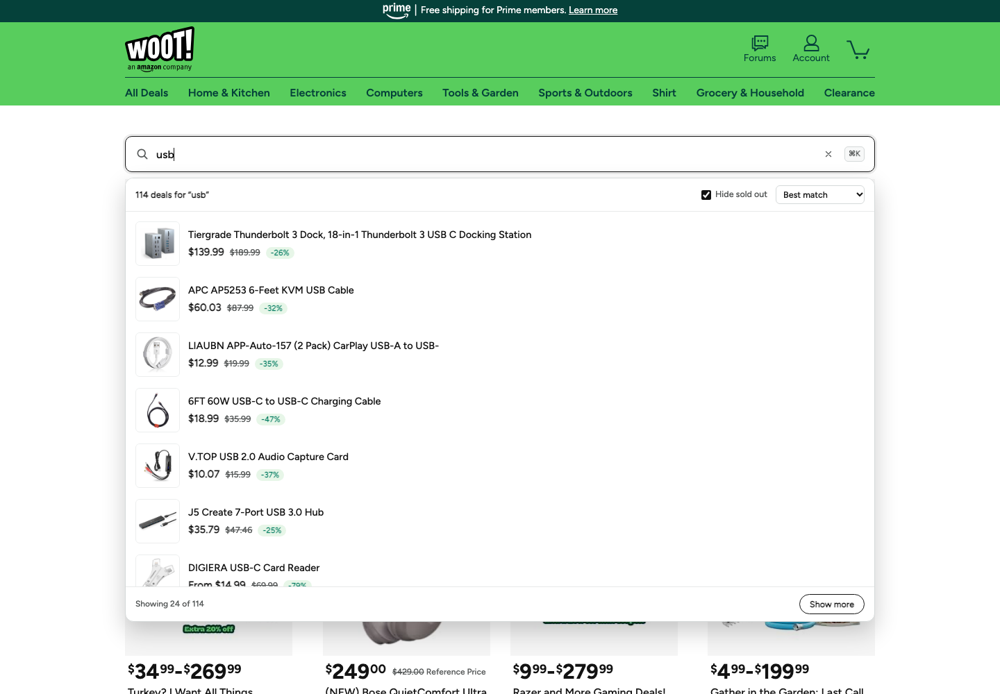

# Woot Deal Search

An unofficial Chrome extension that adds the search box Woot forgot. It puts a
search bar under Woot's header on every Woot page and searches **all live deals
across the site**, not just the page you're on.



> Not affiliated with Woot or Amazon. It only calls the same public deal feed
> Woot's own website uses, plus light caching and debouncing.

## Features

- Search roughly 15,000 live Woot offers as you type.
- See a thumbnail, sale price, original price, and discount for every result.
- Sort by best match, biggest discount, price, or newest.
- Hide sold-out deals (on by default), or show them again.
- Full keyboard support: `Cmd/Ctrl+K` to focus, `↑`/`↓` to move, `Enter` to
  open, `Esc` to close.
- Clicking the toolbar button jumps to search on a Woot tab.
- Works on the home page, category pages, offer pages, and Woot subdomains.
- Remembers your sort and sold-out preferences.
- Handles empty results, timeouts, and offline errors with a retry.

## Install

### From a release (easiest)

1. Download `woot-search-extension.zip` from the
   [latest release](../../releases/latest) and unzip it.
2. Open `chrome://extensions`.
3. Turn on **Developer mode** (top right).
4. Click **Load unpacked** and select the unzipped `woot-search-extension`
   folder.
5. Open <https://www.woot.com/> and look under the header.

### From source

```bash
git clone https://github.com/YOUR_USER/woot-deal-search.git
```

Then load `woot-deal-search/woot-search-extension` as an unpacked extension in
`chrome://extensions`. There is no build step and no dependencies.

After editing any extension file, click the reload button on the extension card
in `chrome://extensions`, then refresh the Woot tab.

## Usage

- Type at least 2 characters, for example `usb`, `airpods`, or `coffee maker`.
- Use the **Hide sold out** checkbox and the sort menu in the results header;
  both choices are remembered.
- Results show the current total for your query. Use **Show more** to load the
  next 24.
- Clicking a result opens its Woot offer page. `Cmd/Ctrl+click` opens it in a
  new tab.

## How it works

Woot's frontend is a React app backed by a public GraphQL endpoint configured in
each page as `window.__WOOT_GQL__`. The extension reads that configuration from
the page, asks its service worker to call `searchOffers`, and renders the
normalized results in a dropdown.

The service worker owns all network requests, so the page's CSP and CORS rules
never get in the way. Responses are cached for 3 minutes and typing is debounced
to keep requests light. If Woot rotates its public endpoint key, the worker
re-reads the key from <https://www.woot.com/> and retries automatically; a
built-in fallback keeps the first search working if page parsing fails.

The endpoint key is public and appears in every Woot page. It is not a secret
and no credentials are stored by this extension.

## Privacy

- No analytics, accounts, tracking, or remote code.
- The only data sent to Woot is the text you search for, and it goes to Woot's
  own API — never to the developer.
- Preferences live in `chrome.storage.local` and never leave the machine.

Read the full [privacy policy](PRIVACY.md).

## Project layout

```
woot-search-extension/    the loadable extension (manifest at its root)
  manifest.json           MV3 manifest
  background.js           service worker: API call, config discovery, cache
  lib.js                  pure normalization helpers (also used by tests)
  content.js              injects the bar, renders results, keyboard handling
  content.css             scoped styles
  icons/                  generated PNGs
tests/
  lib.test.cjs            unit tests for price/image/URL normalization
  e2e.mjs                 headless-browser end-to-end test + screenshot
tools/
  make_icons.py           regenerates the PNG icons
  package.sh              builds the release zip
  package-store.sh        builds the Chrome Web Store zip (manifest at root)
store-assets/
  icon-128.png            store icon (96px artwork + 16px padding)
  screenshot-1280x800.png store screenshot
  promo-440x280.png       optional small promo tile
artifacts/
  woot-search-e2e.png     screenshot used above
PRIVACY.md                privacy policy for the store listing
STORE_LISTING.md          copy, permissions, and checklist for the Chrome Web Store
```

## Development

Requirements: Node.js 20+, Python 3 (only for regenerating icons), and a
Chromium browser (Chrome, Brave, or Chromium) for the end-to-end test.

```bash
# Unit tests
node tests/lib.test.cjs

# End-to-end: loads the extension in headless Brave/Chrome and runs a real search
node tests/e2e.mjs

# If the browser is not in a default macOS location:
BROWSER_PATH=/usr/bin/google-chrome node tests/e2e.mjs

# Rebuild icons, or package the extension for a release
python3 tools/make_icons.py
tools/package.sh
tools/package-store.sh
```

The end-to-end test writes a fresh screenshot to
`artifacts/woot-search-e2e.png`. It requires live network access, so CI runs the
unit and syntax checks only (see `.github/workflows/ci.yml`).

## Releasing

- **GitHub:** run `tools/package.sh` and attach the ZIP to a release.
- **Chrome Web Store:** run `tools/package-store.sh` and follow
  [STORE_LISTING.md](STORE_LISTING.md) for the listing copy, permissions, and
  submission checklist.

## Contributing

Issues and pull requests are welcome. Please keep the extension dependency-free
and run `node tests/lib.test.cjs` before opening a PR. If Woot changes its page
markup, the injection point is `#global-header` in `content.js`.

## License

[MIT](LICENSE)
